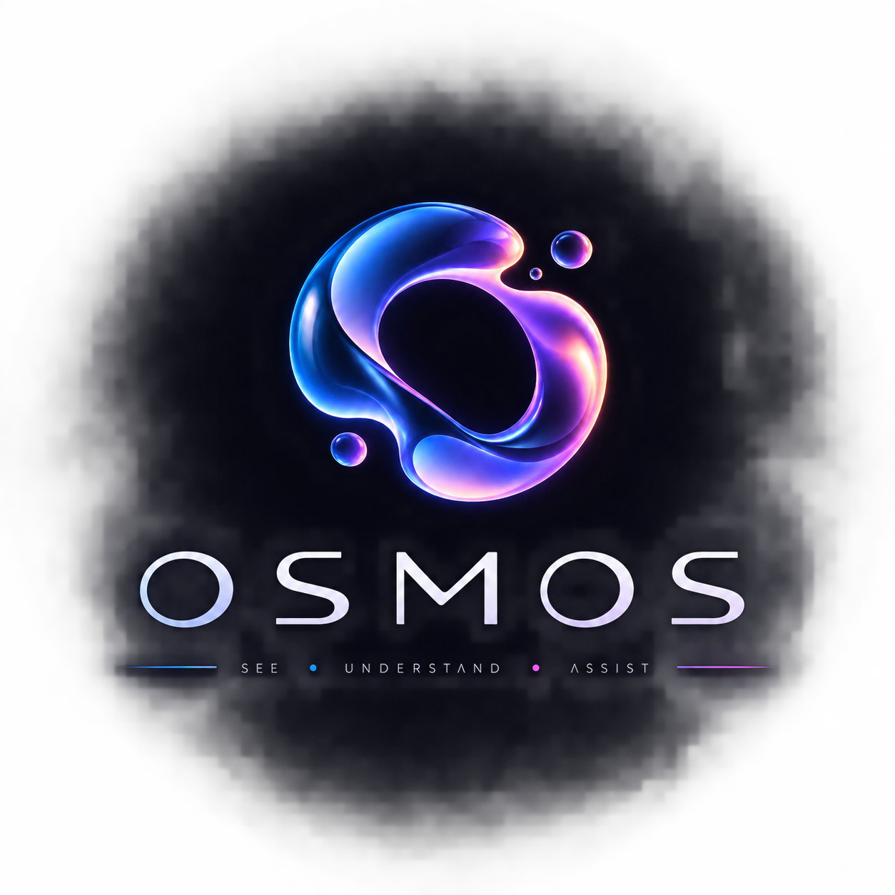

<p align="center">
  
</p>

<h1 align="center">OSMOS</h1>

<p align="center">
  <strong>A local-first desktop copilot for interviews, meetings and calls.</strong><br/>
  It hears the room, reads the screen when you ask it to, and drafts an answer in an overlay — without sending your audio anywhere.
</p>

<p align="center">
  <a href="LICENSE"></a>
  <a href="#platform-support"></a>
  
  
</p>

---

## What it is

OSMOS is an MIT-licensed Electron app that sits in a floating overlay next to your meeting. It captures microphone and speaker audio, transcribes it locally, decides whether a question was actually directed at you, and streams an answer from a model that runs **on your machine** (a bundled Qwen2.5-1.5B) or from a provider you configure with your own key.

There is no account, no telemetry and no subscription. Audio, transcripts, résumés and API keys stay in `~/.config/OSMOS` unless you deliberately point a request at a cloud provider.

| | |
|---|---|
| **Listening** | Mic + speaker loopback → endpointing → local STT (Moonshine tiny by default, Whisper base.en optional) |
| **Reading** | On-demand screen OCR (Tesseract in the main process) through a silent per-OS backend |
| **Answering** | Bundled 1.5B fast lane for immediate drafts, your quality provider for the real answer |
| **Hiding** | OS-level capture exclusion on Windows; `setContentProtection` on macOS; documented limits on Linux |
| **Remembering** | SQLite session memory, hybrid retrieval, offline session reports you can export |

---

## Install

Download from [Releases](https://github.com/taksha17/osmos/releases).

| Build | Size | What it contains |
|---|---|---|
| **Full** | ~1.2 GB | App + `llama-server` runtime + the 940 MB Qwen2.5-1.5B weights |
| **Lite** (`-lite`) | ~284 MB | App + runtime only; the weights are downloaded and SHA-256-verified on first run |

Both are self-contained: no Python, no ffmpeg, no Ollama install required for the local path.

> **The installers are unsigned.** There is no Apple Developer ID and no Windows OV/EV certificate, so:
> - **macOS:** clear quarantine once — `xattr -dr com.apple.quarantine /Applications/OSMOS.app` — then grant Screen Recording, Microphone and Accessibility in System Settings → Privacy & Security.
> - **Windows:** SmartScreen shows "More info → Run anyway".
>
> This is tracked as an open exit criterion in [`docs/ARCHITECTURE-V2.md`](docs/ARCHITECTURE-V2.md) §20, not silently ignored.

### First run

1. The onboarding wizard asks for a profile (optional) and a provider.
2. **Local-only:** leave the provider on the bundled model. **Cloud:** add a key in Settings → Models.
3. Turn on **Smart** to hear the meeting, press <kbd>Ctrl/Cmd</kbd>+<kbd>Enter</kbd> for an answer, <kbd>Alt/Option</kbd>+<kbd>Shift</kbd>+<kbd>C</kbd> to read the screen.

---

## Platform support

Everything below was measured or reproduced on the platform named. Rows that were never verified are labelled **untested** — the UI does not claim them either.

| | Windows | macOS | Linux |
|---|---|---|---|
| Meeting audio (speaker) | Chromium loopback — works out of the box | **Requires BlackHole** + a Multi-Output Device | `ffmpeg -f pulse` on a real `*.monitor` (pw-record fallback) |
| Microphone | ffmpeg DirectShow / Chromium | AVFoundation via ffmpeg | ffmpeg pulse / pw-record |
| Screen reading | GDI capture (silent) | `screencapture -x` + Screen Recording grant | Mutter ScreenCast on GNOME (no picker, no flash); CLI tools elsewhere |
| Capture exclusion | `setContentProtection` (DWM affinity — reads `WDA_MONITOR` on Electron 34; the pixel check needs a real display, see the matrix) | `NSWindowSharingNone` — stops legacy `CGWindowList` capture; **ScreenCaptureKit shares can still include it** | No OS flag — optional GNOME bridge auto-hides the overlay during shares; a window/tab share is still safest |
| Overlay above fullscreen apps | — | yes (`screen-saver` level, `visibleOnFullScreen`) | — |
| Live screen loop | GDI, silent | `screencapture`, silent | GNOME only; never the portal, never `gnome-screenshot` |

**Linux notes.** GNOME live reading needs `python3-gi`, GStreamer and `gstreamer1.0-pipewire` (default on Ubuntu GNOME). Nothing is bundled — the backend is only offered when its probe passes. Wayland cannot register global shortcuts on many setups; the in-app hotkeys still work.

**Ubuntu screen-share hiding.** GNOME/Wayland has no per-window "exclude from capture" flag. Install the optional GNOME Shell **Stealth Bridge** (`bash linux/scripts/install-bridge.sh`, then log out and back in) and OSMOS hides every OSMOS window while any screen share or recording is active. It is auto-hide during sharing — you will not see the overlay either during a full-screen share — and it cannot tell a window share from a monitor share. Settings → Low-profile shows the live bridge state, installs it, and switches its mode. Verify a recording with `linux/scripts/verify-capture.sh <file>` (and run the `mode=keep` negative control). `--selftest` proves the harness can see a leak and does not invent one; OCR uses the bundled tesseract.js, so system `tesseract` is optional. `npm run test:ubuntu-bridge-live` goes further without touching your desktop: it starts a private-bus headless GNOME Shell, opens a real Mutter ScreenCast, captures the PipeWire stream and checks the window is visible in `mode=keep`, absent while hidden and back afterwards (needs `gst-launch-1.0` with `pipewiresrc`, `pw-dump`, `python3-gi`, `python3-pil`). Chrome/Zoom/OBS and Alt-Tab/Dock still need the manual §9 pass.

**macOS notes.** Meeting audio needs a virtual cable (BlackHole or Loopback) plus a Multi-Output Device; without one the app refuses to record instead of silently transcribing your microphone. `docs/STEALTH-MATRIX.md` lists every capture-app combination as measured, partial or **untested**.

---

## Build from source

```bash
git clone https://github.com/taksha17/osmos.git
cd osmos
npm install

npm run dev          # Vite on :5179 + Electron, OSMOS_DEV=1
npm run typecheck    # tsc for app + node configs
npm test             # 243 unit tests (src/shared + src/main)
npm run build        # renderer + main + workers
```

Package on the matching host — each OS embeds its own `llama-server` runtime and its own ffmpeg:

```bash
npm run pack:linux    # AppImage + deb
npm run pack:mac      # dmg (must run on macOS)
npm run pack:win      # NSIS installer
node scripts/pack.mjs --lite            # runtime only, weights downloaded on first run
```

`ensure-ffmpeg` and `ensure-bundled-llm` stage the vendored runtimes (gitignored, ~1 GB). On macOS ffmpeg is compiled from pinned LGPL source, and `scripts/sign-vendored-macos.mjs` ad-hoc signs every vendored Mach-O — **without that signature Apple Silicon kills the helper on spawn**.

Do not run `pack:all`: electron-builder cannot cross-build a working mac/win package from Linux. Pull-request CI runs typecheck and tests on Ubuntu, macOS and Windows; the pack matrix in `.github/workflows/release.yml` runs only for `v*` tags.

### Useful checks

```bash
npm run bench                    # replay harness: triggers, latency, screen kinds (gated ≥ 0.9 accuracy)
npm run capture:fixtures -- screen --dir ./screens   # label real screenshots into a fixture set
npm run probe:stealth            # Windows: does the overlay actually leave Alt-Tab and exclude capture?
```

---

## How it works

```
renderer (React)
  │  ChatRequest { message, history, screenText?, screenAt? }   ← raw context, never prompt text
  ▼
main
  ├─ capture workers (supervised, external)      mic + speaker → utterance events
  ├─ endpointing            shared/policy/vadEndpoint.ts
  ├─ trigger policy         shared/policy/triggerPolicy.ts   "was this a question for me?"
  ├─ orchestrator           shared/policy/orchestrator.ts    speculative start → keep | restart | cancel
  ├─ routing + budget       shared/policy/routerV2.ts · contextBudget.ts · answerContext.ts
  ├─ screen classification  shared/policy/screenSnapshot.ts  (code / terminal / slides / chat)
  ├─ providers              Ollama · OpenAI · Anthropic · Groq · OpenRouter · NVIDIA NIM · LiteLLM · vision
  └─ memory                 sql.js SQLite store + shared/policy/memoryRanking.ts
  ▼
overlay  ← one window per app, presented without stealing focus
```

Three rules shape the codebase:

1. **Capture never runs inline in `main/index.ts`.** Workers are separate processes behind a supervisor with a stall watchdog and restart backoff, so a wedged `ffmpeg` cannot freeze the UI.
2. **Policy is pure and unit-tested.** Trigger decisions, routing, budgeting and ranking live in `src/shared/policy/*` and are driven by the `bench/` replay harness from plain Node — no Electron needed.
3. **Screen data stays in main.** The renderer sends OCR text plus a timestamp; the grabbed image never crosses the preload boundary.

`docs/ARCHITECTURE-V2.md` is the full specification (seven phases, each with its exit criteria and what was measured). `AGENTS.md` is the contributor contract.

---

## Measured, not claimed

Numbers from `docs/BENCHMARKS.md`, produced on a Windows 11 test box and a Linux Zenbook. Re-run with `npm run bench`.

| Metric | Result |
|---|---|
| Endpointing, end-of-speech p50 | **460 ms** |
| End-of-speech → final transcript p50 | **510 ms** (WER 6.5 %) |
| End-of-question → first token, bundled 1.5B | **p50 49 ms / p95 348 ms** |
| Trigger precision / recall | **1.000 / 1.000** on 43 labelled utterances |
| Screen-kind accuracy / code recall | **1.0 / 1.0** on the fixture set (gate: ≥ 0.9 / ≥ 0.85) |
| Idle cost while listening | ≈ 3 % CPU, ≈ 93 MB RSS |
| 30-minute meeting summary | 18.4 s on the bundled 1.5B |
| Unit tests | **243** passing |

Cloud-lane latency and vision recall are **not** measured — they need provider keys this repository does not ship. The harness prints `row skipped` rather than inventing a number.

---

## Privacy

- **Nothing leaves the machine** unless you configure a cloud provider or cloud STT. The bundled model, local STT and OCR run offline.
- **API keys** live in the local settings store, never in the repo or in logs.
- **Recording indicator.** A visible `● REC` chip is shown whenever capture is active; Settings → *Delete all sessions & transcripts* purges stored sessions.
- **Consent is your responsibility.** Many jurisdictions require all-party consent to record a conversation. Hardware HDMI capture and a phone camera will always see an overlay — capture exclusion is software, not a guarantee.

---

## Documentation

| Doc | What it answers |
|---|---|
| [`docs/ARCHITECTURE-V2.md`](docs/ARCHITECTURE-V2.md) | The v2 specification, phase by phase, with exit criteria and measurements |
| [`docs/BENCHMARKS.md`](docs/BENCHMARKS.md) | Every measured number and how it was produced |
| [`docs/STEALTH-MATRIX.md`](docs/STEALTH-MATRIX.md) | Capture exclusion per OS and per meeting app, including what is untested |
| [`docs/CAPTURE-STRATEGY.md`](docs/CAPTURE-STRATEGY.md) | Why screen capture differs per desktop, and the silent path chosen |
| [`docs/ROADMAP.md`](docs/ROADMAP.md) | What is done, what is next, what is blocked on hardware |
| [`docs/REGRESSIONS.md`](docs/REGRESSIONS.md) | Bugs that were fixed and must not come back |
| [`docs/SELF-HOSTING.md`](docs/SELF-HOSTING.md) | Running optional web-access backends yourself |
| [`docs/ARCHITECTURE-V3.md`](docs/ARCHITECTURE-V3.md) | The in-progress web-access layer (scaffold) |
| [`AGENTS.md`](AGENTS.md) | Conventions, invariants and the validation checklist for contributors |

---

## Status

- **v2 is implemented end to end:** phases 0–7 are in `main`, with the numbers above.
- **v3 (self-hosted web access)** is a scaffold — the capability router and Web Access Manager exist; chat still calls the v0.6 search path.
- **Open, and honest about it:** signed/notarized installers (no certificates), vision accuracy on real providers (no keys), and the macOS/Linux halves of the stealth matrix that need a real meeting app on a real desktop.

## Contributing

Read [`AGENTS.md`](AGENTS.md) first — it holds the invariants (policy in `shared/policy`, capture in workers, nothing new in `main/index.ts`, platform behaviour behind `src/main/platform/`). Before declaring a change done: `npm run typecheck`, `npm test`, `npm run build`, and `npm run bench` for anything that touches routing, prompts or triggers.

## License

MIT — see [LICENSE](LICENSE). Bundled third-party runtimes keep their own licences: ffmpeg is an unmodified **LGPL** build ([source](https://github.com/BtbN/FFmpeg-Builds)); `llama.cpp` is MIT and the Qwen2.5-1.5B weights are Apache-2.0; Tesseract.js is Apache-2.0 and Moonshine is MIT. Full list: [`THIRD-PARTY-NOTICES.md`](THIRD-PARTY-NOTICES.md).
