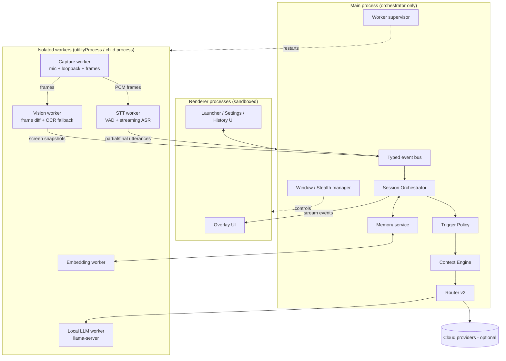

# OSMOS Architecture v2

> **Status:** Accepted — Phase 0 in progress · **Target release:** v1.0 · **Baseline:** v0.6.0
> **Audience:** maintainers and contributors (human or AI agent)
> **Supersedes:** the capture/assist sections of `AGENTS.md` once accepted

---

## 1. Why v2

v0.6.0 has the right ingredients (local-first, multi-OS, profiles, hybrid routing) but the live-session experience trails Cluely and Natively. The causes are structural, not cosmetic:

| # | Problem in v0.6.0 | Evidence in the repo | Effect |
|---|---|---|---|
| 1 | Screen understanding is OCR-only | No image input anywhere in `providers.ts`; Tesseract 2–3.7 s per frame (AGENTS.md) | Code, diagrams and slides lose structure; slow |
| 2 | Audio is batch-transcribed in fixed 4–6 s chunks | `CONTINUOUS_CHUNK_MS = 6000`, `transcribeChunkMs \|\| 4000` | Seconds of dead time before the LLM sees the question |
| 3 | "When to answer" is a heuristic on text length | `shouldAutoAssist`: question-like or ≥ 36 chars | Noisy triggers, missed questions |
| 4 | Local STT requires a system `node` | `resolveNodeBinary()` in `localWhisper.ts` | Breaks the zero-dependency promise on clean machines |
| 5 | Capture lives in the main process with no isolation | `micStream.ts`, `linuxLoopbackStream.ts`, `screenLive.ts` all in main | A stalled pipe or OCR spike can block IPC; Smart-listen mic bug is "PARKED" |
| 6 | No post-session output | No summary / action-item / export code | Users have no reason to keep the app after the call |
| 7 | No eval or benchmark harness | 13 unit tests on pure functions only; `npm test` runner broken on Node 22 | Cannot tell if a change made things better |
| 8 | Stealth = capture exclusion only | Overlay is a focusable `BrowserWindow`; no Dock/Alt-Tab/process hiding | Steals focus; easy to detect |

v2 is a restructuring around **one real-time pipeline with a measurable latency budget**, **isolated worker processes**, **multimodal context**, and **a test/benchmark harness that gates merges**.

---

## 2. Goals and non-goals

### Goals (measurable)

| Metric | v0.6.0 (est.) | v2 target |
|---|---|---|
| End of question → first answer token (p50) | 5–10 s | **≤ 1.5 s** |
| End of question → first answer token (p95) | not measured | **≤ 2.5 s** |
| Screen change → context available | 2–4 s (OCR) | **≤ 1.0 s** (vision-ready frame), OCR async |
| Local STT word error rate (clean English, 16 kHz) | not measured | **≤ 12 %** on the fixture set |
| Cold start to "listening" | not measured | **≤ 4 s** with local models warm |
| Idle CPU while listening (no speech) | not measured | **≤ 3 %** of one core |
| Clean-machine install works without Node/Python/ffmpeg | partially | **100 %** on Win/macOS/Ubuntu |
| Crash isolation | none | A worker crash never kills the overlay |

### Non-goals (v2)

- Cloud sync, accounts, or any server-side component.
- Mobile apps (tracked separately).
- Training or fine-tuning models.
- Guaranteeing invisibility against hardware capture or proctoring that inspects processes. Stealth is best-effort and documented as such.

---

## 3. Design principles

1. **One pipeline, one clock.** Every event (audio, frame, token) carries a monotonic timestamp so end-to-end latency can be measured anywhere.
2. **Workers are disposable.** Capture, STT, vision and local LLM run in separate processes with supervised restart. Main only orchestrates.
3. **Interfaces before implementations.** STT, vision, LLM and embedding providers sit behind small typed interfaces. Swapping Moonshine for Parakeet, or Ollama for Groq, never touches the orchestrator.
4. **Local by default, cloud by choice.** Nothing leaves the machine unless the user selects a cloud provider for that capability.
5. **Never block the audio path.** Audio frames are copied into a ring buffer; everything downstream is asynchronous with backpressure policies (drop-oldest for frames, never for audio).
6. **Speculate, then reconcile.** Start generating on partial transcripts; cancel or upgrade when the final transcript differs.
7. **No answer without an eval.** Routing rules, prompts and trigger policy change only with a benchmark result attached.
8. **Honest by default.** A visible recording indicator and one-click purge remain on (see §14).

---

## 4. Target architecture

### 4.1 Process model



**Rules**

- Main contains **no** audio decoding, no OCR, no inference, no heavy loops.
- Workers talk to main over a single typed channel (`MessagePort` for `utilityProcess`, length-prefixed binary over stdio for external binaries).
- The renderer never talks to workers directly; it only receives view-model events from main.

### 4.2 End-to-end data flow

```
Mic ─┐                                   ┌─► Partial transcript ─► (speculative LLM start)
     ├─► Capture ─► Ring buffer ─► VAD ──┤
Spk ─┘      (per-channel)                └─► Final utterance ────┐
                                                                  ▼
Screen ─► Frame grabber ─► Change detect ─► Vision snapshot ─► Context Engine ─► Router ─► LLM ─► Overlay
                                                                  ▲
Profile / Question bank / Docs / Past sessions (Memory) ──────────┘
```

---

## 5. Audio pipeline v2

### 5.1 Capture worker

- **Per-channel streams:** `mic` (user) and `spk` (system loopback) captured independently and tagged with `channel` and a shared monotonic clock.
- **Format:** 16 kHz mono s16le in 20 ms frames, written to a lock-free ring buffer (60 s capacity per channel).
- **Backends** (behind `AudioBackend` interface, selected per OS):
  - Windows: Chromium/WASAPI loopback (existing) with a native fallback later.
  - macOS: ScreenCaptureKit audio (macOS 13+), BlackHole fallback.
  - Linux: `ffmpeg -f pulse` on `*.monitor`, `pw-record` fallback (keep the existing rule: never `parec`).
- **Supervision:** if no frames arrive for 3 s while the device is active, the supervisor restarts the backend and emits `capture.degraded`. This replaces the ad-hoc respawn and renderer watchdog and is the intended fix for the parked mic-stream bug.
- **Serialization:** the Linux audio lock (`withLinuxAudioLock`) moves inside the capture worker so no other component needs to know about it.

### 5.2 VAD and utterance segmentation

- **Silero VAD (ONNX)** runs on 32 ms windows per channel.
- States: `silence → speech → hangover → endpoint`.
- Parameters (tunable, defaults to be set by benchmark):
  - `minSpeechMs = 250`
  - `endpointHangoverMs = 450` (question-ending pause)
  - `maxUtteranceMs = 25 000` (force a flush)
  - `preRollMs = 300` (audio kept before speech onset)
- Emits `utterance.start`, `utterance.partial`, `utterance.end` with channel, timestamps and the audio slice reference.
- Silence is never sent to the STT worker, which also removes the current RMS-gate logic from the renderer.

### 5.3 Streaming STT

Provider interface:

```ts
interface SttProvider {
  id: string;                          // 'sherpa-streaming' | 'moonshine' | 'whisper-cpp' | 'deepgram' | 'groq-whisper' ...
  capabilities: { streaming: boolean; local: boolean; languages: string[] };
  start(opts: { sampleRate: 16000; language?: string }): SttSession;
}
interface SttSession {
  push(frame: Int16Array, tsMs: number): void;   // never blocks
  onPartial(cb: (t: { text: string; tsMs: number }) => void): void;
  onFinal(cb: (t: { text: string; startMs: number; endMs: number; confidence?: number }) => void): void;
  close(): Promise<void>;
}
```

- **Default local engine (to be decided by benchmark, see §13):** a streaming transducer via `sherpa-onnx` (CPU, MIT/Apache models) or `whisper.cpp` in chunked-streaming mode. Moonshine-tiny stays as the low-RAM fallback (keep the existing `q8` dtype pin).
- **Optional cloud engines:** Deepgram / Groq Whisper / OpenAI, same interface, user-selected, keys in the OS keychain.
- **Runtime:** the STT worker is an Electron `utilityProcess` (or `child_process.fork` with `ELECTRON_RUN_AS_NODE=1` using `process.execPath`). This removes the system-Node requirement. *Validation task:* confirm `onnxruntime-node` loads under Electron's Node on all three OSes before committing to this.

### 5.4 Speaker attribution

- **Level 1 (v2.0):** channel label only — `me` (mic) vs `them` (loopback).
- **Level 2 (v2.1):** on the `them` channel, run lightweight speaker embeddings (sherpa-onnx speaker model) with online clustering to label `Speaker A/B/C`. Labels are session-local and never persisted as biometric data.
- Transcript model stores `{ channel, speakerId?, text, startMs, endMs, isFinal }`.

---

## 6. Vision pipeline v2

### 6.1 Frame acquisition

Keep the existing silent backends (they encode hard-won platform lessons from AGENTS.md):

| OS | Primary | Fallback |
|---|---|---|
| GNOME | Mutter ScreenCast (`screen_worker.py`) | CLI (`grim`, `spectacle`) one-shot only |
| Windows | GDI capture | `getDisplayMedia` |
| macOS | ScreenCaptureKit (preferred) / `screencapture -x` | `getDisplayMedia` |

Hard rules carried over: no looped portal capture on Wayland; no looped `gnome-screenshot`.

### 6.2 Change detection and region of interest

- Downscale to 480 px wide, perceptual hash plus pixel-diff ratio; ignore the overlay's own rectangle by **masking its known bounds** (replaces the current text-level `stripOverlayEcho` as the first line of defence; keep the text strip as a backstop).
- Emit a snapshot only when the diff exceeds a threshold **and** the frame has been stable for ~400 ms (avoids capturing mid-scroll).
- Optional active-window crop (title bar + client area) to reduce tokens.

### 6.3 Dual-path understanding

```
Stable frame ─┬─► Vision path  : JPEG/WebP (≤ 1568 px long edge) ─► multimodal model (on demand)
              └─► Text path    : OCR (async, cached by frame hash) ─► searchable text for context + RAG
```

- **Text path (always on, cheap):** Tesseract today; evaluate a faster engine (e.g. platform OCR APIs: Windows.Media.Ocr, macOS Vision) behind `OcrProvider`.
- **Vision path (on demand):** only attached to a request when the trigger policy says the screen matters (coding problem, slide, diagram, chart). Never streamed continuously to a cloud provider.
- **Snapshot object:**

```ts
type ScreenSnapshot = {
  id: string; capturedAtMs: number; hash: string;
  activeApp?: string; activeTitle?: string;
  imageRef: string;            // path in a per-session temp dir, deleted on purge
  ocrText?: string;            // filled asynchronously
  regions?: Array<{ kind: 'code' | 'text' | 'chart' | 'ui'; bbox: [number, number, number, number] }>;
};
```

### 6.4 Multimodal provider support

`LlmProvider` gains an `images` input (see §8). Supported targets: OpenAI-compatible vision models, Anthropic, Gemini, Groq vision models, and local vision models via Ollama (e.g. Qwen2.5-VL, Llama vision). If the selected model has no vision, the router falls back to OCR text and shows a one-line notice.

---

## 7. Orchestrator, context engine and trigger policy

### 7.1 Event bus (typed)

All components publish/subscribe typed events. Examples:

```ts
type OsmosEvent =
  | { t: 'utterance.partial'; channel: 'me'|'them'; text: string; tsMs: number }
  | { t: 'utterance.final';   channel: 'me'|'them'; text: string; startMs: number; endMs: number; speakerId?: string }
  | { t: 'screen.snapshot';   snapshot: ScreenSnapshot }
  | { t: 'trigger.fire';      reason: TriggerReason; at: number }
  | { t: 'answer.delta';      requestId: string; text: string; phase: 'draft'|'final' }
  | { t: 'answer.done';       requestId: string; stats: AnswerStats }
  | { t: 'worker.status';     worker: WorkerId; state: 'starting'|'ready'|'degraded'|'crashed' };
```

Every event is also appended (optionally) to a session log used by the benchmark harness for replay.

### 7.2 Context Engine

Builds a **ContextPacket** for each request. It is the only place prompts are assembled (preserves the existing rule that the renderer never sends prompt text).

```ts
type ContextPacket = {
  mode: 'interview' | 'meeting' | 'general' | 'coding';
  question: { text: string; speaker: string; isFinal: boolean };
  recentTranscript: Array<{ who: string; text: string }>;   // token-budgeted window
  screen?: { snapshotId: string; includeImage: boolean; ocrText?: string };
  profile?: { resumeFacts: string[]; jdFacts: string[]; companyIntel?: string };
  bankMatch?: { questionId: string; answer: string; score: number };
  retrieved?: Array<{ source: string; text: string; score: number }>;  // docs + past sessions
  constraints: { maxSpokenSeconds: number; language: string; format: 'speakable' | 'bullets' | 'code' };
};
```

- **Token budgeting:** fixed budgets per section (e.g. transcript 800, profile 600, retrieved 800, screen OCR 600), trimmed by relevance, never by arbitrary slicing.
- **Grounding rule (interview mode):** profile facts are passed as a structured list; the system prompt forbids inventing employers, dates or skills. Add an automated check in the eval set (see §13).

### 7.3 Trigger Policy

Replaces `shouldAutoAssist`. Inputs: final/partial utterance, speaker channel, conversation state, screen change, user hotkey.

| Trigger | Condition | Action |
|---|---|---|
| **Hotkey** | User presses Assist | Always fire with latest context |
| **Direct question** | Final utterance on `them` channel classified as a question addressed to the user | Fire; speculative start on partial if classifier confidence ≥ 0.8 |
| **Coding/problem screen** | Snapshot classified as a problem statement and stable | Offer (don't auto-fire) in `coding` mode; auto-fire if user enabled it |
| **Meeting cue** | Action item, decision, or name-mention detected | Add to notes, no answer unless asked |
| **Self-speech** | Utterance on `me` channel | Never fire; update context only |

- **Question classifier:** start with rules (current regexes plus interrogative-intonation hints), then a small local classifier (≈ 20–50 MB) trained/evaluated on the fixture set. The policy is a pure function so it can be unit-tested and replayed.
- **Cooldown and dedupe:** do not re-fire for the same utterance hash within 10 s; cancel any in-flight request when a newer question arrives.

### 7.4 Speculative generation

1. On a `partial` that the classifier marks as a likely question, start the fast-lane model with the partial text.
2. On `final`: if the final text is semantically unchanged (edit distance below threshold), keep streaming; otherwise cancel and restart.
3. Quality lane runs in parallel when the router asks for it; the overlay shows the fast draft, then replaces it (existing draft-then-upgrade behaviour, now driven by the orchestrator).

All requests have a `requestId`, a cancellation token and a deadline.

---

## 8. LLM layer and Router v2

### 8.1 Provider interface

```ts
interface LlmProvider {
  id: string;
  capabilities: { vision: boolean; streaming: true; maxContext: number; local: boolean };
  stream(req: {
    system: string;
    messages: ChatMessage[];
    images?: Array<{ mime: string; dataRef: string }>;
    signal: AbortSignal;
    maxTokens?: number;
  }): AsyncIterable<{ kind: 'delta' | 'thinking' | 'done'; text?: string; usage?: Usage }>;
}
```

Existing providers (Ollama, OpenAI-compatible, Anthropic, bundled `llama-server`) are adapted to this interface. Hybrid routing stays but is now data-driven.

### 8.2 Router v2

- Inputs: `ContextPacket` features (question length, has image, has bank match, mode, historical latency per provider).
- Output: ordered **lane plan**, e.g. `[fast-local → quality-cloud]` or `[vision-cloud]`.
- Replace keyword lists with:
  1. **Hard rules** that must hold (screenshot-with-code → vision-capable lane; no vision model → OCR fallback).
  2. **Learned/benchmarked thresholds:** the "easy question goes local" boundary is chosen by eval accuracy, not by word count (today `EASY_MAX_WORDS = 18`).
  3. **Safety rule:** a small local model may answer from a bank match or from profile facts, but must not generate new personal claims. Enforced by the grounding eval.
- **Fallback chain:** timeout (first token > 2.5 s) or error → next lane; user-visible status line says which lane answered.
- **Warmup:** keep the existing provider warmup, plus keep-alive pings for local servers.

### 8.3 Prompts as versioned assets

Move prompts out of code into `src/shared/prompts/*.md` with a version header. Each prompt change must include the eval run ID in the PR description.

---

## 9. Memory service

- **Storage:** SQLite (`better-sqlite3`) with `sqlite-vec` for vectors. Electron 34 ships Node 20, so `node:sqlite` is not available; the native module must be rebuilt per platform (`electron-rebuild`) and unpacked from asar.
- **Embeddings:** local model via the embedding worker (ONNX, e.g. a small MiniLM-class model) behind `EmbeddingProvider`; optional cloud embeddings. Store model id and dimension per row (use per-dimension tables to avoid mixing).
- **Schema (v1):**

```sql
sessions(id, started_at, ended_at, mode, profile_id, title)
utterances(id, session_id, channel, speaker_id, start_ms, end_ms, text)
answers(id, session_id, request_id, question_utterance_id, lane, text, latency_ms, rating)
snapshots(id, session_id, captured_at, hash, ocr_text, image_path)   -- image_path nullable, purge-able
chunks(id, source_type, source_id, text, model, dim)                 -- docs, resume, past sessions
vec_chunks_<dim>(rowid, embedding)
notes(id, session_id, kind, text)                                    -- action items, decisions
```

- **Retrieval:** hybrid BM25 (FTS5) + vector with reciprocal-rank fusion; replaces TF-IDF in `retrieval.ts`.
- **Migration:** import existing `chat-history.json` and profile documents on first launch of v2; keep the old file until the import is verified.
- **Purge:** one transaction deletes rows and image files; "Delete all" must leave no recoverable text on disk.

---

## 10. Post-session intelligence

New service `SessionReport` runs when a session ends (or on demand):

- **Outputs:** summary, decisions, action items (owner, due if stated), open questions, follow-up email draft, and for interviews: questions asked, answers given, STAR coverage, improvement notes.
- **Execution:** map-reduce over transcript windows using the user's chosen model (local by default); progress shown in the History tab.
- **Export:** Markdown, JSON, plain text; optional `.ics` for action items. All local files.
- **Ask-your-history:** natural-language questions answered through the memory retrieval path (§9).

---

## 11. Stealth and window management v2

The overlay behaves as a *non-activating utility surface*.

| Concern | Windows | macOS | Linux |
|---|---|---|---|
| Excluded from capture | `WDA_EXCLUDEFROMCAPTURE` (existing) | `NSWindowSharingNone` / content protection (existing); validate on ScreenCaptureKit | Not available — document "share a tab/window" |
| Don't steal focus | `focusable: false` while visible; focus only when the user clicks the input | Non-activating `NSPanel` (`type: 'panel'`) | `showInactive`, no focus grab |
| Hide from task switchers | Tool-window style (`WS_EX_TOOLWINDOW`) | Accessory activation policy, `app.dock.hide()` | `skipTaskbar` |
| Click-through mode | `setIgnoreMouseEvents(true, { forward: true })`, toggled by hotkey | Same | Same where supported |
| Global hotkeys that work unfocused | Yes | Yes | Best-effort (Wayland limits) |
| Process/window naming | Configurable display name (optional, off by default) | Same | Same |

**Verification matrix (blocking for v1.0):** automated or scripted manual tests of Zoom, Teams, Google Meet (browser and app), Webex and OBS on each OS, recording the result in `docs/STEALTH-MATRIX.md` with OS/app versions and date. Anything not verified is labelled "untested" in the UI.

Stealth features are opt-in and sit next to the persistent recording indicator (§14).

---

## 12. Coding-interview mode

A first-class mode (`coding`) instead of a keyword in the router:

1. **Detect:** snapshot classifier flags a problem statement or an editor with failing tests.
2. **Capture:** keep the last N snapshots (problem, constraints, user's current code) as a rolling visual context.
3. **Answer structure:** restate → approach → complexity → code in the detected language → edge cases. Output format `code` renders with syntax highlighting and one-tap copy.
4. **Follow-ups:** "optimize it", "why this approach", "find the bug in my code" use the stored snapshots plus prior answer.
5. **Model policy:** vision-capable quality lane by default; local fast lane only for syntax lookups.

---

## 13. Quality, testing and benchmarks

v2 is merged only if it can be **measured**.

### 13.1 Test layers

| Layer | Tooling | Scope |
|---|---|---|
| Unit | `node --test` via the existing esbuild bundling | Trigger policy, router, context budgeting, prompt assembly |
| Contract | Fake providers | Every provider interface behaves identically on stream/cancel/error |
| Pipeline replay | Recorded event logs | Feed a saved `OsmosEvent` log and assert the produced answers/latency |
| Audio fixtures | 30–60 short clips (clean, noisy, accented, crosstalk) with reference text | WER + endpoint accuracy |
| Screen fixtures | 40–80 screenshots (code problems, slides, charts, chats) with expected facts | Vision/OCR extraction accuracy |
| E2E smoke | Playwright/Electron, virtual audio device in CI | App launches, captures fixture audio, shows an answer |
| Stealth | Manual matrix (§11) | Per OS release |

**Runner (done in Phase 0):** `scripts/run-shared-tests.mjs` walks `src/shared/**`, bundles each `*.test.ts` with the esbuild devDependency, and passes the built `.mjs` files explicitly to `node --test` — identical behaviour on Node 20 and 22.

### 13.2 Benchmark harness (`npm run bench`)

Outputs a JSON + Markdown report per run:

- Latency: endpoint → first token (p50/p95), per lane and per STT engine.
- STT: WER, real-time factor, memory.
- Vision: key-fact recall on screen fixtures, tokens per frame.
- Grounding: % of interview answers containing claims not present in the profile.
- Trigger quality: precision/recall of "should answer" on labelled transcripts.
- Resource: CPU/RAM while idle-listening and while answering.

CI runs the deterministic subset (unit, contract, replay) on every PR; the full benchmark runs nightly or on demand on a pinned machine and posts results to the PR.

### 13.3 Acceptance gates

A phase is "done" only when its exit criteria (§17) hold **in the benchmark report**, not by manual impression.

---

## 14. Privacy, consent and security

- **Recording indicator:** persistent `● REC` chip whenever any capture is active; cannot be hidden by the stealth setting.
- **Data locality:** all session data under the app data dir; images stored per session and deleted on purge or after a configurable retention (default 7 days).
- **Secrets:** provider keys in the OS keychain (`safeStorage`, as today). If encryption is unavailable, show a visible warning rather than silently writing plaintext.
- **No telemetry:** unchanged. Crash dumps stay local.
- **Cloud transparency:** the overlay shows which provider handled each answer and whether audio/screen content left the device.
- **IPC hardening:** schema-validated IPC payloads (e.g. `zod`), no `nodeIntegration`, context isolation on, strict CSP, DOMPurify on rendered markdown (existing).
- **Worker sandboxing:** workers receive only the file paths and handles they need; no shell access from model output, ever.
- **Legal notices:** keep consent-law guidance in the README and first-run wizard. Use is the user's responsibility; document that deceiving an interviewer or exam proctor may breach their rules.
- **Clean-room rule:** do not read, copy or paraphrase source from licensed competitors. Reimplement from public documentation and behaviour only; record provenance in `THIRD-PARTY-NOTICES.md` and have a second contributor review any code that resembles a reference app.

---

## 15. Packaging and distribution

- **Zero-dependency runtime:** all workers use bundled runtimes (Electron's Node via `utilityProcess`/`ELECTRON_RUN_AS_NODE`, bundled ffmpeg, bundled `llama-server`). Remove `resolveNodeBinary()` PATH search from the production path (keep for dev).
- **Model management:** models are downloaded on first run (or bundled in a "full" installer) into `models/` with SHA-256 verification, resumable downloads, and a Settings page showing size and purpose. Ship a *lite* installer (no models) and a *full* installer.
- **Signing:** Windows (OV/EV certificate or Azure Trusted Signing), macOS (Developer ID + notarization). Until then, label builds "unsigned" on the release page with the exact bypass steps.
- **CI:** standard GitHub-hosted runners are free for public repositories, so restore the pack matrix for tagged releases (Windows, macOS, Ubuntu) and keep typecheck + tests on every PR.
- **Updates:** signed update feed (`electron-updater`), with delta updates for the app and separate versioning for model packs.
- **Docs hygiene:** correct README claims (the frozen binary is the audio-capture worker, not Whisper), reconcile model sizes (0.5B vs 1.5B), and correct the comparison table against competitors' current public statements.

---

## 16. Target repository layout

```
src/
  shared/
    events.ts              # OsmosEvent union (single source of truth)
    contracts/             # SttProvider, LlmProvider, OcrProvider, EmbeddingProvider, AudioBackend
    prompts/               # versioned prompt assets (*.md)
    policy/                # triggerPolicy.ts, routerV2.ts, contextBudget.ts (pure, tested)
  main/
    orchestrator/          # session lifecycle, event bus wiring, deadlines, cancellation
    context/               # ContextEngine, ContextPacket builders
    memory/                # sqlite, migrations, retrieval, purge
    report/                # SessionReport (summaries, exports)
    stealth/               # window manager per platform
    supervisor/            # worker spawn, health, restart, backoff
    providers/             # llm/, stt/, ocr/, embed/ adapters
  workers/
    capture/               # audio backends + frame grabbers
    stt/                   # VAD + streaming ASR
    vision/                # frame diff, OCR, region detection
    embed/                 # embeddings
  renderer/                # views only; consumes view-model events
  python/                  # Mutter screen worker only (until replaced)
bench/
  fixtures/{audio,screens,transcripts}/
  run.mjs               # replay + latency report (npm run bench)
docs/
  ARCHITECTURE-V2.md  STEALTH-MATRIX.md  BENCHMARKS.md  REGRESSIONS.md
```

---

## 17. Migration plan

Each phase ships behind a feature flag and keeps v0.6 behaviour as the fallback until its exit criteria pass.

### Phase 0: Foundations (1–2 weeks)

> **Phase 0 status:** implemented — `src/shared/events.ts`, `src/shared/contracts/*`,
> delegating `src/shared/policy/*` with parity tests, `bench/` replay harness +
> baseline in `docs/BENCHMARKS.md`, `docs/REGRESSIONS.md`, and a 3-OS
> typecheck + test CI matrix (packaging still runs per OS host).

- Fix the test runner; add CI for tests.
- Introduce `events.ts` and the provider contracts; adapt existing providers without changing behaviour.
- Build the benchmark harness skeleton and record **baseline numbers for v0.6**.
- Fix docs inaccuracies (§15).
- **Exit:** baseline report committed; CI green; no behaviour change.

### Phase 1: Runtime and isolation (2 weeks)

> **Phase 1 status:** implemented behind kill switches.
> `src/shared/policy/workerRuntime.ts` (bundled `ELECTRON_RUN_AS_NODE` runtime,
> restart backoff, stall rules — tested), `src/main/supervisor/workerSupervisor.ts`
> (spawn / JSON-lines channel / stderr tail / watchdog / supervised restart),
> `src/workers/capture/capture-worker.mjs` (ffmpeg pipe + WAV chunking outside
> main) and `src/main/services/captureWorkerClient.ts` (backend selection stays in
> main; `mic:listen-*` and `system:listen-*` use it, falling back to the inline
> streams with a visible status line). The STT worker now launches on the bundled
> runtime, falling back to system Node only when asked.
> Escapes: `OSMOS_CAPTURE_WORKERS=0`, `OSMOS_WORKER_RUNTIME=system`,
> `OSMOS_NODE_BINARY=…`.
>
> **Exit evidence (measured 2026-11-20):**
>
> | Check | Result |
> |---|---|
> | 30-minute soak, real monitor, 2 s chunks | 899 chunks / 1 799 beats, max gap **2 040 ms** (2 000 ms chunk + frame), **0 errors, 0 restarts** |
> | No `node`, no `ffmpeg` on PATH (Linux, shims that fail if called) | PASS — worker on bundled runtime, 5 chunks/12 s, 0 errors |
> | Windows bundled runtime (`ELECTRON_RUN_AS_NODE`) | PASS — worker `ready`+`pong` on Electron 34.5.8 / Node 20.19.1 with `onnxruntime-node` 1.24.3 loading |
> | Supervisor kill/restart | PASS — 2 chunks → kill → restart logged → 2 more chunks |
> | Capture smoke, system Node + bundled runtime | PASS — valid WAV both ways |
> | Unit tests | Linux 80/80, Windows 66/66 |
> | Windows NSIS install, clean PATH | PASS — `OSMOS Setup 0.6.0.exe` (1.26 GB) re-packed from `f3e520b` and installed silently to `%LOCALAPPDATA%\Programs\OSMOS`; with `node`, `python`, `ffmpeg` and `npm` absent from PATH the installed worker captured 2 valid WAV chunks and Moonshine transcribed a SAPI sentence (8/8 probe checks), and the packaged app booted with its renderer and `llama-server` children |
> | Linux packaged tree, empty PATH | PASS — `release/linux-unpacked` (AppImage 1.5 GB) with `PATH=/tmp/nobin` captured from the real sink monitor through its bundled ffmpeg and transcribed on the bundled runtime, 8/8 checks |
> | Windows audio endpoints (interactive session) | environment gap — 0 present `AudioEndpoint` devices; bundled ffmpeg's dshow enumeration lists the NVIDIA Broadcast **camera** and prints `Could not enumerate audio only devices (or none found)`, so no live mic source exists on that box |
>
> The installer run also caught a bug that config review had missed:
> `app.asar.unpacked` workers run under plain Node, which never looks inside
> `app.asar`, so the per-package `asarUnpack` list dropped transitive modules
> (`detect-libc`, `@img/colour`) and packaged Whisper died with
> `Cannot find module 'detect-libc'`. `asarUnpack` now unpacks all of `node_modules`.
>
> The Windows endpoint probe also found a real defect that config review had missed:
> the dshow fallback named `Win32_SoundDevice` adapters, which can report `OK` while
> exposing no endpoint (Realtek/AMD/NVIDIA cards on that box), so the app offered
> microphones ffmpeg could not open. It now lists `AudioEndpoint` PnP devices, returns
> nothing on that box, and the UI says no DirectShow microphone is available instead
> of naming an unopenable device (`AGENTS.md`, Symptom J2). The re-packed app logs
> `[dshow] no audio devices parsed from ffmpeg stderr; trying audio-endpoint fallback`
> at startup, so the shipped binary runs the new path.
>
> Still open: **macOS**, which has no host on this project at all, and live-device
> capture on the Windows box, which is an environment gap rather than a code gap — the
> same worker and bundled ffmpeg are driven from a `lavfi` tone there. Ubuntu was
> verified from the packaged tree (`linux-unpacked`, AppImage built; the real sink
> monitor captured through the bundled ffmpeg) rather than a fresh install, so the
> `.deb` path still needs a clean machine.

- Move STT into a `utilityProcess` using the bundled Node; remove the system-Node dependency.
- Add the worker supervisor with health checks and restart.
- Move mic/loopback capture into the capture worker; fix the parked mic-stream bug with supervised restart and logging of close codes + stderr tail.
- **Exit:** clean-VM install on Win/macOS/Ubuntu transcribes without Node installed; 30-minute soak with zero capture stalls.

### Phase 2: Real-time audio (2–3 weeks)

> **Phase 2 status (slice 1):** utterance endpointing is in and measured.
> `src/shared/policy/vadEndpoint.ts` implements the §5.2 state machine
> (silence → speech → hangover → endpoint, 250/450/25 000/300 ms defaults, pre-roll ring)
> with 10 unit tests; the capture worker (now TypeScript, bundled by
> `scripts/build-workers.mjs` so it shares that one implementation) emits
> `utterance` messages next to the legacy fixed chunks.
> Measured on the Zenbook: a 1.2 s tone through the sink monitor produced an
> utterance with `speechMs=1220`, 1 760 ms of audio (300 ms pre-roll + hangover)
> and **431 ms endpoint latency** against the 450 ms hangover budget.
> Remaining for Phase 2: swap the energy test for Silero VAD (same state
> machine), switch `useSystemAudioStt` / `useMainMicStt` to transcribe utterances
> instead of fixed chunks, and add the audio fixture set + WER harness.

- Silero VAD + utterance endpointing.
- Streaming STT engine chosen by benchmark; Moonshine kept as fallback.
- Replace fixed chunking in `useSystemAudioStt` / `useMainMicStt`.
- **Exit:** end-of-question → final transcript ≤ 600 ms p50 on the audio set; WER within target.

### Phase 3: Orchestrator, trigger policy, speculative generation (2 weeks)

> **Phase 3 status (2026-11-21):** the trigger policy and orchestrator are live in the
> auto-ask path (`ChatPanel.ingestFinal`), so behaviour changed: mic finals are the `me`
> channel and never answer, meeting cues are dropped as notes, the same question inside
> 10 s is a duplicate, and a superseding question cancels the stream that is running.
> The lane plan and the context packet are not wired yet — both live in
> `src/main/index.ts`, which currently carries another agent's uncommitted web-access work.
> `src/shared/policy/triggerPolicy.ts` now implements the §7.3 table — hotkey, direct
> question, coding screen (offer, auto-fire only when enabled), meeting cue as a
> **note**, self-speech never, 10 s dedupe, speculative partials at classifier
> confidence ≥ 0.8. `src/shared/policy/orchestrator.ts` is the §7.4 lifecycle as a pure
> action-returning state machine: speculative start, reconcile-or-restart at 20 % edit
> distance, cancel on a newer question, 15 s deadline. `src/shared/policy/contextBudget.ts`
> builds the §7.2 `ContextPacket` with per-section token budgets and relevance-based
> trimming. `src/shared/policy/routerV2.ts` adds the §8.2 hard rules (code snapshot →
> vision lane, no vision model → OCR text), an explicit threshold input in place of the
> `EASY_MAX_WORDS` constant, and a fallback chain that ends at the quality lane after a
> 2.5 s first-token budget.
>
> **Exit evidence (measured 2026-11-21, Windows box):**
>
> | Check | Result |
> |---|---|
> | Trigger precision / recall, 43 labelled utterances | **1.000 / 1.000** (gate ≥ 0.9 / ≥ 0.85; first run 0.952, both misses fixed by two classifier rules) |
> | Unit tests | 110/110, 30 of them new for §7.2–§7.4 |
> | Replay set through `npm run bench` | 7 answerable utterances; 2 correctly skipped (one meeting cue, one self-speech) |
> | **End-of-question → first token, real model** | **p50 49 ms / p95 348 ms** (gate ≤ 1.5 s / ≤ 2.5 s), bundled Qwen2.5-1.5B Q4_K_M through the packaged `llama-server`, 7 samples |
>
> Still open: wiring `planLanes` and the §7.2 context packet into the chat path (both
> require `src/main/index.ts`, held by another agent's uncommitted work), so the lane plan
> is bench-only and `buildContextPacket` has no production caller yet; speculative start,
> which needs the partial utterances Phase 2 is adding; the cloud/quality lane of the
> latency gate (measured on the local 1.5B fast lane only — no provider key on the test
> box); and an accuracy set for `pickEasyMaxWords`, so the boundary stays at the v0.6
> default of 18 words. Trigger quality is measured on a hand-written 43-utterance set, and
> the first run's two misses were fixed by the rules derived from them — an independent
> corpus is needed before 1.000 is treated as a general result (`docs/BENCHMARKS.md`).

- Implement Orchestrator, Context Engine, Trigger Policy, request cancellation/deadlines.
- Router v2 with eval-driven thresholds and fallback chain.
- **Exit:** end-of-question → first token ≤ 1.5 s p50 / ≤ 2.5 s p95 on replay set; trigger precision ≥ 0.9, recall ≥ 0.85 on labelled transcripts.

### Phase 4: Vision (2–3 weeks)
- Frame grabber with change detection and overlay masking.
- Multimodal provider support; OCR as async text path.
- Coding mode with rolling snapshot context.
- **Exit:** screen fixtures meet recall target; screenshot → first token ≤ 3 s with a cloud vision model.

### Phase 5: Memory and reports (2 weeks)
- SQLite + sqlite-vec, hybrid retrieval, data migration from JSON.
- SessionReport and exports.
- **Exit:** migration tested on real v0.6 data; summary generated for a 30-minute transcript in ≤ 60 s locally (or provider-dependent for cloud).

### Phase 6: Stealth and polish (2 weeks)
- Non-activating overlay, task-switcher hiding, click-through toggle.
- Stealth verification matrix completed and published.
- Speaker labels level 2.
- **Exit:** matrix filled for Win/macOS with Zoom/Teams/Meet/Webex/OBS; overlay never takes focus in the focus-loss test.

### Phase 7: Distribution (ongoing, parallel)
- Code signing, notarization, update feed, full/lite installers, restored CI pack matrix.
- **Exit:** installers pass Gatekeeper/SmartScreen without manual override.

---

## 18. Risks and mitigations

| Risk | Likelihood | Impact | Mitigation |
|---|---|---|---|
| `onnxruntime-node` fails under Electron's Node on some OS | Medium | High | Early spike in Phase 0; fall back to a bundled standalone Node binary |
| Streaming local STT too slow on low-end CPUs | Medium | High | Benchmark on a low-end reference machine; keep Moonshine/cloud options; show a "slow device" hint |
| Native modules (`better-sqlite3`, `sqlite-vec`) complicate packaging | Medium | Medium | CI matrix builds per OS; asarUnpack; smoke test packaged app |
| Wayland/GNOME restrictions change | Medium | Medium | Keep capability probes and clear degraded-mode messaging |
| macOS ScreenCaptureKit exclusion behaves differently across versions | Medium | High | Matrix per macOS version; label unverified combinations |
| Small local model hallucinates personal facts | High | High | Grounding eval gate; restrict local lane to bank/profile-grounded answers |
| Scope creep across 7 phases with few maintainers | High | High | Flags, strict exit criteria, ship Phase 1–3 as v0.8 before continuing |
| Licence contamination from reference apps | Low | High | Clean-room rule, provenance log, second-reviewer check (§14) |

---

## 19. Open questions

1. Which streaming STT engine wins on the fixture set (sherpa-onnx streaming vs whisper.cpp chunked vs Moonshine)?
2. Is a dedicated question classifier needed, or do rules plus the router's first-token signal suffice?
3. Do we adopt Rust/Tauri for the capture worker (smaller footprint) or keep Electron + native helpers?
4. Should the vision path ever stream continuously to a cloud model, or remain strictly on-demand?
5. Default retention for screenshots: 0 days, 7 days, or per-session only?
6. Do we ship models in the installer, download on first run, or both?

---

## 20. Definition of done for v2

- [ ] All Phase exit criteria met in committed benchmark reports.
- [ ] p50 end-of-question → first token ≤ 1.5 s (local fast lane) and ≤ 2.5 s p95.
- [ ] Clean-machine install works on Windows, macOS and Ubuntu with no manual dependencies.
- [ ] Vision path works with at least two cloud providers and one local model.
- [ ] Session reports and exports available offline.
- [ ] Stealth matrix published; unverified combinations clearly labelled.
- [ ] Signed/notarized installers published.
- [ ] README, ROADMAP, AGENTS.md and `features.ts` updated and consistent with this document.
- [ ] No personal paths, LAN addresses or secrets in the repository.

---

## Appendix A: Latency budget (target, p50)

| Stage | Budget |
|---|---|
| Speaker stops → VAD endpoint (hangover) | 450 ms |
| Final transcript from streaming ASR (tail decode) | 150 ms |
| Trigger policy + context assembly | 50 ms |
| Router decision | 5 ms |
| LLM first token (local fast lane / warm cloud) | 300 / 600 ms |
| Event delivery + overlay render | 30 ms |
| **Total (local fast lane)** | **≈ 1.0 s** |
| **Total (warm cloud lane)** | **≈ 1.3 s** |

Speculative generation (§7.4) can hide the VAD hangover and part of the ASR tail by starting on a confident partial.

## Appendix B: Event log format (for replay)

```jsonl
{"t":"utterance.final","channel":"them","text":"Tell me about a time you led a project.","startMs":10320,"endMs":13180}
{"t":"trigger.fire","reason":"direct-question","at":13640}
{"t":"answer.delta","requestId":"r1","text":"At my last role","phase":"draft"}
{"t":"answer.done","requestId":"r1","stats":{"firstTokenMs":980,"lane":"fast-local"}}
```

The benchmark harness replays these logs against fake or real providers to compare versions deterministically.

## Appendix C: Mapping from v0.6 to v2

| v0.6 file | v2 destination |
|---|---|
| `main/services/micStream.ts`, `linuxLoopbackStream.ts` | `workers/capture/*` (audio backends) |
| `main/services/localWhisper.ts`, `scripts/whisper-worker.mjs` | `workers/stt/*` + `providers/stt/*` |
| `main/services/screenLive.ts`, `mutterScreenCast.ts`, `screenCapture.ts` | `workers/capture/frames` + `workers/vision/*` |
| `main/services/ocr.ts` | `providers/ocr/tesseract.ts` |
| `shared/continuousAssist.ts` | `shared/policy/triggerPolicy.ts` + `main/context/*` |
| `shared/lumenRoute.ts`, `main/services/hybridChat.ts` | `shared/policy/routerV2.ts` + `main/orchestrator/*` |
| `main/services/providers.ts` | `main/providers/llm/*` |
| `main/services/retrieval.ts`, `history.ts` | `main/memory/*` |
| `main/platform/index.ts` (stealth parts) | `main/stealth/*` |
| `main/index.ts` (1.3k lines) | split across `orchestrator/`, `supervisor/`, IPC modules |
| `main/services/agentMcp.ts` (stubs) | Out of v2 scope; revisit after Phase 5 |
