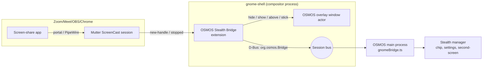

# OSMOS Ubuntu Update: GNOME "Stealth Bridge"

> **Status:** Implementation guide + test plan · **Applies to:** Ubuntu (GNOME on Wayland) · **Extends:** `ARCHITECTURE-V2.md` §11 (Stealth) and `ARCHITECTURE-V3.md`
> **Primary target:** Ubuntu 24.04 LTS (GNOME Shell 46). **Second target:** the newest Ubuntu LTS you can get (GNOME Shell version differs; see §1).
> **Honesty note:** the code below is a *starting point written from API knowledge*. The shipped extension has now been run on GNOME Shell 46 (headless live test, §T0.5), but every claim marked **VERIFY** must still be re-confirmed on your exact Shell version using §9. Do not ship before the matrix in §10 is filled for your build.
>
> **Implementation status (2026-11-21):** shipped as `linux/gnome-extension/` +
> `src/main/platform/linux/gnomeBridge.ts` + `src/shared/policy/ubuntuBridge.ts`, with a
> setup card in Settings → Low-profile. `npm run probe:ubuntu-bridge` covers the D-Bus
> contract against a mock service. `npm run test:ubuntu-bridge-live` now proves the core
> hide path in a private-bus headless GNOME Shell with a real Mutter ScreenCast and a
> PipeWire capture: the window is visible in `mode=keep`, absent while hidden and back
> afterwards. Chrome/Zoom/OBS, Alt-Tab/Dock, first-frame timing and an OCR canary
> recording still require §9 on a real desktop.
>
> Deliberate deviations from the code below:
> - `prefs.js` imports from `resource:///org/gnome/Shell/...` (capital S). The lowercase
>   path in §4.4 does not exist.
> - The extension records which actors *it* hid and only restores those, so ending a share
>   never force-shows an overlay the user had hidden.
> - `install-bridge.sh` copies by default (`--link` is the dev fast loop), so moving or
>   removing a packaged app cannot break the installed extension.
> - OSMOS appends Chromium `--class=osmos`, giving a stable WM_CLASS / app id for `app-ids`
>   in dev and packaged builds.
> - The D-Bus interface stays read-only; the app changes mode with
>   `gsettings --schemadir`, and §11's contract test is `npm run probe:ubuntu-bridge`.
> - The installer writes `org.gnome.shell enabled-extensions` through `gjs` when the running
>   Shell refuses `gnome-extensions enable` for a just-installed extension, so the next login
>   starts the bridge instead of requiring a second manual command.
> - While hiding, the extension also sets `skip_taskbar` (guarded, restored afterwards) so the
>   windows leave Alt-Tab and the Overview grid. That call is best-effort; hiding works without it.
> - `verify-capture.sh --selftest` proves the canary harness with synthetic leaking and clean
>   recordings, using the bundled `tesseract.js` when system tesseract is absent.
> - `test-bridge-live.sh` (`npm run test:ubuntu-bridge-live`) runs a throwaway headless GNOME
>   Shell, loads the installed extension, opens a real Mutter ScreenCast and captures its
>   PipeWire stream. On 2026-11-21 all 12 checks passed: the window was in the capture in
>   `mode=keep` (67,200 magenta samples), absent while hidden (0), back after a mode switch
>   and after the share ended; `SharingActive` was observed 115–276 ms after `Session.Start`
>   (signal timing with 20 ms polling, not a first-frame measurement).
>   It proves the compositor hide and the capture harness, not Chrome/Zoom/OBS on a desktop.

---

## 0. What this update does (and does not do)

### Problem
On Windows, OSMOS marks its overlay as "excluded from capture", so the overlay stays visible to the user but not in a screen share. **GNOME/Wayland has no such per-window flag** (KDE is adding one; GNOME is not known to have one). OSMOS therefore cannot hide itself from a capture, and a normal Wayland app cannot control its own always-on-top state either.

### Solution (v1 of the Ubuntu update)
A small **GNOME Shell extension** (the "Stealth Bridge") that runs inside the compositor and:

1. **Detects screen sharing/recording** using the Shell's remote-access controller (the same source GNOME uses for its own "you are sharing your screen" indicator).
2. **Hides the OSMOS overlay while any share/recording is active**, and restores it when it ends.
3. **Pins the overlay** (always-on-top, all workspaces), which Wayland clients cannot do themselves.
4. **Publishes state over D-Bus** (`org.osmos.Bridge`) so the OSMOS app knows the bridge is installed and whether sharing is active.

### Not in scope (be honest in the UI and README)
- It is **not** "visible to me, invisible to the capture". It is *auto-hide during sharing*. If you share a single **window or browser tab**, the overlay is never part of the capture anyway; if you share the **whole screen**, the overlay disappears for you too.
- It cannot tell a window-share from a monitor-share (the handle carries no source info), so it hides in both cases.
- Hardware capture cards, phones pointed at the screen and proctoring that inspects processes are out of scope.
- A true per-window "exclude from capture" would need a compositor change (Mutter) or an upstream GNOME feature. That is a research track (§12), not part of v1.

> Use only where the rules of the meeting, interview, exam or employer allow it. Keep the OSMOS recording indicator and consent notes.

---

## 1. Environment check (do this first)

```bash
# Session must be Wayland
echo $XDG_SESSION_TYPE                 # expect: wayland

# Ubuntu + GNOME versions (decide the extension's shell-version list from this)
lsb_release -ds
gnome-shell --version                  # e.g. GNOME Shell 46.x on Ubuntu 24.04

# Tools used in this guide
sudo apt update
sudo apt install -y gnome-shell-extension-prefs gnome-shell-extensions \
    libglib2.0-dev-bin dbus-x11 ffmpeg tesseract-ocr python3 curl \
    python3-pil gstreamer1.0-tools gstreamer1.0-pipewire
# (glib-compile-schemas comes from libglib2.0-dev-bin; gnome-extensions CLI ships with gnome-shell)

# Is the Shell's remote-access controller available? (run in Looking Glass, see §5.4)
#   global.backend.get_remote_access_controller()   -> should print an object, not null
```

**Version matrix**

| Ubuntu | GNOME Shell | Notes |
|---|---|---|
| 24.04 LTS | 46 | Reference target. Extensions use ES modules (`import`/`export`). |
| Newer LTS | Newer | Add its major version to `shell-version` in `metadata.json`. Re-run every test. Private APIs may have changed. |

Rule: **never add a version to `metadata.json` that you have not tested.**

---

## 2. Architecture



Design rules:

- The extension holds **no secrets**, makes **no network calls**, and only reads *how many* share handles exist, never their content.
- If the bridge is absent, OSMOS works exactly as before and shows "Ubuntu bridge: not installed".
- Fail-safe preference: **when in doubt, hide** (mode `hide` is the default).

---

## 3. Repository layout

```
linux/
  gnome-extension/
    osmos-bridge@osmos.app/
      metadata.json
      extension.js
      prefs.js
      schemas/
        org.gnome.shell.extensions.osmos-bridge.gschema.xml
  scripts/
    install-bridge.sh
    uninstall-bridge.sh
    verify-capture.sh
    test-bridge-live.sh     # headless Shell + real Mutter ScreenCast capture
  test/
    share-test.html          # local getDisplayMedia test page
src/main/platform/linux/
  gnomeBridge.ts             # D-Bus client in OSMOS
docs/
  STEALTH-MATRIX.md          # filled test results (from §10)
```

---

## 4. The extension (complete source)

### 4.1 `metadata.json`

```json
{
  "uuid": "osmos-bridge@osmos.app",
  "name": "OSMOS Stealth Bridge",
  "description": "Hides the OSMOS overlay while the screen is being shared or recorded and keeps it pinned on top. Reads only the number of active share sessions.",
  "shell-version": ["46"],
  "settings-schema": "org.gnome.shell.extensions.osmos-bridge",
  "version": 1,
  "url": "https://github.com/taksha17/osmos"
}
```

### 4.2 `schemas/org.gnome.shell.extensions.osmos-bridge.gschema.xml`

```xml
<?xml version="1.0" encoding="UTF-8"?>
<schemalist>
  <schema id="org.gnome.shell.extensions.osmos-bridge"
          path="/org/gnome/shell/extensions/osmos-bridge/">
    <key name="mode" type="s">
      <default>'hide'</default>
      <summary>Behaviour when a share starts</summary>
      <description>hide = hide the overlay while sharing; keep = never hide (use for the negative-control test); off = do nothing.</description>
    </key>
    <key name="app-ids" type="as">
      <default>['osmos', 'Osmos', 'OSMOS']</default>
      <summary>Window identifiers to manage</summary>
      <description>Matched (case-insensitively) against the window's GTK application id, WM_CLASS and WM_CLASS instance.</description>
    </key>
    <key name="keep-above" type="b">
      <default>true</default>
      <summary>Pin the overlay on top and on all workspaces</summary>
    </key>
  </schema>
</schemalist>
```

### 4.3 `extension.js`

```js
// OSMOS Stealth Bridge — GNOME Shell 45+ (ES module) extension
import GLib from 'gi://GLib';
import Gio from 'gi://Gio';
import {Extension} from 'resource:///org/gnome/shell/extensions/extension.js';

const BUS_NAME = 'org.osmos.Bridge';
const OBJ_PATH = '/org/osmos/Bridge';
const VERSION = '1';

const IFACE_XML = `
<node>
  <interface name="${BUS_NAME}">
    <method name="Ping">
      <arg type="s" direction="out" name="version"/>
    </method>
    <property name="SharingActive" type="b" access="read"/>
    <property name="Mode" type="s" access="read"/>
    <signal name="SharingChanged">
      <arg type="b" name="active"/>
    </signal>
  </interface>
</node>`;

export default class OsmosBridge extends Extension {
  enable() {
    this._settings = this.getSettings();
    this._handles = new Set();          // active share/record handles
    this._handleIds = new Map();        // handle -> 'stopped' signal id
    this._actorSignals = new Map();     // actor -> [signal ids]
    this._timeouts = new Set();         // pending GLib sources
    this._sharing = false;

    this._exportDBus();
    this._hookRemoteAccess();

    this._settingIds = ['mode', 'app-ids', 'keep-above'].map(key =>
      this._settings.connect(`changed::${key}`, () => this._apply()));

    this._winCreatedId = global.display.connect('window-created',
      (_display, win) => this._onWindowCreated(win));

    this._apply();
    console.log('[osmos-bridge] enabled');
  }

  disable() {
    // 1. stop reacting
    if (this._winCreatedId) global.display.disconnect(this._winCreatedId);
    this._winCreatedId = null;
    for (const id of this._settingIds ?? []) this._settings.disconnect(id);
    this._settingIds = null;

    if (this._ctrl && this._newHandleId) this._ctrl.disconnect(this._newHandleId);
    this._newHandleId = null;
    for (const [handle, id] of this._handleIds) {
      try { handle.disconnect(id); } catch (_e) { /* already gone */ }
    }
    this._handleIds.clear();
    this._handles.clear();
    this._sharing = false;

    for (const id of this._timeouts) GLib.source_remove(id);
    this._timeouts.clear();

    // 2. restore everything we touched
    for (const actor of global.get_window_actors()) {
      this._disconnectActor(actor);
      const win = actor.meta_window;
      if (win && this._matches(win) && !win.minimized) actor.show();
    }
    for (const [actor] of this._actorSignals) this._disconnectActor(actor);
    this._actorSignals.clear();

    // 3. drop D-Bus
    this._unexportDBus();
    this._settings = null;
    this._ctrl = null;
    console.log('[osmos-bridge] disabled');
  }

  // ---------- screen-share detection ----------
  _hookRemoteAccess() {
    this._ctrl = global.backend.get_remote_access_controller?.() ?? null;
    if (!this._ctrl) {
      console.warn('[osmos-bridge] no remote-access controller; cannot detect sharing');
      return;
    }
    this._newHandleId = this._ctrl.connect('new-handle', (_ctrl, handle) => {
      this._handles.add(handle);
      const id = handle.connect('stopped', () => {
        try { handle.disconnect(id); } catch (_e) { /* ignore */ }
        this._handleIds.delete(handle);
        this._handles.delete(handle);
        this._updateSharing();
      });
      this._handleIds.set(handle, id);
      this._updateSharing();
    });
    // LIMITATION (verify in test T7): handles that existed before enable() are not listed.
  }

  _updateSharing() {
    const active = this._handles.size > 0;
    if (active === this._sharing) return;
    this._sharing = active;
    console.log(`[osmos-bridge] sharing=${active} t=${GLib.get_monotonic_time()}`);
    this._apply();                                   // hide/show first (latency-critical)
    this._dbus?.emit_signal('SharingChanged', new GLib.Variant('(b)', [active]));
    this._dbus?.emit_property_changed('SharingActive', new GLib.Variant('b', active));
  }

  // ---------- window handling ----------
  _matches(win) {
    const wanted = this._settings.get_strv('app-ids').map(s => s.toLowerCase());
    const have = [
      win.get_gtk_application_id?.(),
      win.get_wm_class?.(),
      win.get_wm_class_instance?.(),
    ].filter(Boolean).map(s => s.toLowerCase());
    return have.some(h => wanted.includes(h));
  }

  _shouldHide() {
    return this._settings.get_string('mode') === 'hide' && this._sharing;
  }

  _apply() {
    for (const actor of global.get_window_actors()) this._applyTo(actor);
  }

  _applyTo(actor) {
    const win = actor.meta_window;
    if (!win || !this._matches(win)) return;
    if (this._settings.get_string('mode') === 'off') {
      this._disconnectActor(actor);
      return;
    }

    if (this._settings.get_boolean('keep-above')) {
      if (!win.is_above()) win.make_above();
      win.stick();
    }

    // Re-hide if anything (workspace switch, animation) tries to show it during a share.
    if (!this._actorSignals.has(actor)) {
      const ids = [
        actor.connect('notify::visible', () => {
          if (this._shouldHide() && actor.visible) actor.hide();
        }),
        actor.connect('destroy', () => this._actorSignals.delete(actor)),
      ];
      this._actorSignals.set(actor, ids);
    }

    if (this._shouldHide()) actor.hide();
    else if (!win.minimized) actor.show();
  }

  _disconnectActor(actor) {
    const ids = this._actorSignals.get(actor);
    if (!ids) return;
    for (const id of ids) {
      try { actor.disconnect(id); } catch (_e) { /* destroyed */ }
    }
    this._actorSignals.delete(actor);
  }

  _onWindowCreated(win) {
    // app id / class may not be set yet at creation time; retry a couple of times
    for (const delay of [50, 250, 1000]) {
      const id = GLib.timeout_add(GLib.PRIORITY_DEFAULT, delay, () => {
        this._timeouts.delete(id);
        const actor = win.get_compositor_private?.();
        if (actor) this._applyTo(actor);
        return GLib.SOURCE_REMOVE;
      });
      this._timeouts.add(id);
    }
  }

  // ---------- D-Bus ----------
  _exportDBus() {
    this._dbus = Gio.DBusExportedObject.wrapJSObject(IFACE_XML, this);
    this._dbus.export(Gio.DBus.session, OBJ_PATH);
    this._ownerId = Gio.bus_own_name(
      Gio.BusType.SESSION, BUS_NAME, Gio.BusNameOwnerFlags.NONE, null, null, null);
  }

  _unexportDBus() {
    if (this._ownerId) Gio.bus_unown_name(this._ownerId);
    this._ownerId = null;
    this._dbus?.unexport();
    this._dbus = null;
  }

  // D-Bus members
  Ping() { return VERSION; }
  get SharingActive() { return this._sharing; }
  get Mode() { return this._settings?.get_string('mode') ?? 'off'; }
}
```

### 4.4 `prefs.js`

```js
import Adw from 'gi://Adw';
import Gtk from 'gi://Gtk';
import {ExtensionPreferences} from 'resource:///org/gnome/Shell/Extensions/js/extensions/prefs.js';

export default class OsmosBridgePrefs extends ExtensionPreferences {
  fillPreferencesWindow(window) {
    const settings = this.getSettings();
    const page = new Adw.PreferencesPage();
    const group = new Adw.PreferencesGroup({title: 'Screen-share behaviour'});

    const modes = ['hide', 'keep', 'off'];
    const row = new Adw.ComboRow({
      title: 'When sharing starts',
      model: Gtk.StringList.new(['Hide the overlay', 'Keep visible (testing only)', 'Do nothing']),
    });
    row.selected = Math.max(0, modes.indexOf(settings.get_string('mode')));
    row.connect('notify::selected', () => settings.set_string('mode', modes[row.selected]));
    group.add(row);

    const pin = new Adw.SwitchRow({title: 'Pin overlay on top and on all workspaces'});
    settings.bind('keep-above', pin, 'active', 0 /* Gio.SettingsBindFlags.DEFAULT */);
    group.add(pin);

    page.add(group);
    window.add(page);
  }
}
```

> **VERIFY (API drift):** a few call names (`get_remote_access_controller`, `Meta.Window` helpers) can change between GNOME versions. If the extension fails to load, open Looking Glass (§5.4) and read the error; fix against the Shell source for your exact version rather than guessing.

---

## 5. Install, enable and develop

### 5.1 Install script (`linux/scripts/install-bridge.sh`)

```bash
#!/usr/bin/env bash
set -euo pipefail
UUID="osmos-bridge@osmos.app"
SRC="$(cd "$(dirname "$0")/../gnome-extension/$UUID" && pwd)"
DEST="$HOME/.local/share/gnome-shell/extensions/$UUID"

mkdir -p "$(dirname "$DEST")"
ln -sfn "$SRC" "$DEST"                      # symlink so edits take effect after reload
glib-compile-schemas "$SRC/schemas"
echo "Installed to $DEST"
echo "Wayland cannot restart the shell in place. Log out and back in, then run:"
echo "  gnome-extensions enable $UUID"
```

`uninstall-bridge.sh`:

```bash
#!/usr/bin/env bash
UUID="osmos-bridge@osmos.app"
gnome-extensions disable "$UUID" 2>/dev/null || true
rm -rf "$HOME/.local/share/gnome-shell/extensions/$UUID"
echo "Removed. Log out/in to fully unload."
```

### 5.2 First enable

```bash
bash linux/scripts/install-bridge.sh
# log out and back in (Wayland), then:
gnome-extensions enable osmos-bridge@osmos.app
gnome-extensions info osmos-bridge@osmos.app       # expect: State: ENABLED
gnome-extensions prefs osmos-bridge@osmos.app      # opens the settings window
```

### 5.3 Fast dev loop (without logging out each time)

Run a **nested** shell so a crash cannot take down your real session. The flag depends on the GNOME version, so check `gnome-shell --help`:

```bash
# GNOME 46 (Ubuntu 24.04):
dbus-run-session -- gnome-shell --nested --wayland
# Newer GNOME (dev kit):
dbus-run-session -- gnome-shell --devkit
```

Inside the nested session open a terminal and enable the extension there. Note that portal-based sharing apps are easier to test in the real session (§9), so use the nested shell mainly to check that the extension loads and the D-Bus interface appears.

### 5.4 Logs and debugging

```bash
journalctl -f -o cat /usr/bin/gnome-shell | grep -i osmos-bridge     # live log

# Looking Glass: press Alt+F2, type  lg  , Enter
#   Extensions tab  -> shows load errors for the extension
#   Windows tab     -> shows each window's app id / wm_class (use to fill 'app-ids')
#   Evaluator       -> try:  global.backend.get_remote_access_controller()
```

**Find your real window id** (needed for the `app-ids` setting):

1. Launch OSMOS.
2. In Looking Glass → *Windows* tab, find the OSMOS overlay and note its **app id** and **wm_class**.
3. Set it:

```bash
gsettings --schemadir linux/gnome-extension/osmos-bridge@osmos.app/schemas \
  set org.gnome.shell.extensions.osmos-bridge app-ids "['osmos','<your-id-here>']"
```

---

## 6. OSMOS app integration

### 6.1 Make the overlay identifiable

- Set a fixed app name (`app.setName('osmos')`) and ship a `.desktop` file with `StartupWMClass=osmos` so the id is stable across launches.
- Electron may run under Wayland natively or through XWayland; the extension matches both `app_id` and `WM_CLASS`, so whichever you get is fine once it is listed in `app-ids`.

### 6.2 D-Bus client (`src/main/platform/linux/gnomeBridge.ts`)

```ts
import dbus from 'dbus-next';          // pure-JS D-Bus client; add as a dependency
import { EventEmitter } from 'node:events';

export type BridgeState = {
  installed: boolean;     // bridge name present on the session bus
  sharing: boolean;       // a share/recording is active
  mode?: string;
  version?: string;
};

export class GnomeBridge extends EventEmitter {
  private bus = dbus.sessionBus();
  private state: BridgeState = { installed: false, sharing: false };
  private timer?: NodeJS.Timeout;

  start() { void this.connect(); this.timer = setInterval(() => void this.connect(), 3000); }
  stop()  { if (this.timer) clearInterval(this.timer); }

  getState() { return this.state; }

  private async connect() {
    if (this.state.installed) return;
    try {
      const obj = await this.bus.getProxyObject('org.osmos.Bridge', '/org/osmos/Bridge');
      const iface = obj.getInterface('org.osmos.Bridge');
      const props = obj.getInterface('org.freedesktop.DBus.Properties');

      const sharing = (await props.Get('org.osmos.Bridge', 'SharingActive')).value as boolean;
      const mode = (await props.Get('org.osmos.Bridge', 'Mode')).value as string;
      const version = (await iface.Ping()) as string;
      this.set({ installed: true, sharing, mode, version });

      iface.on('SharingChanged', (active: boolean) => this.set({ sharing: active }));

      // Detect the bridge disappearing (extension disabled / shell restarted)
      const dbusObj = await this.bus.getProxyObject('org.freedesktop.DBus', '/org/freedesktop/DBus');
      dbusObj.getInterface('org.freedesktop.DBus').on('NameOwnerChanged',
        (name: string, _old: string, next: string) => {
          if (name === 'org.osmos.Bridge' && !next) this.set({ installed: false, sharing: false });
        });
    } catch {
      /* bridge not installed yet; retry on next tick */
    }
  }

  private set(patch: Partial<BridgeState>) {
    this.state = { ...this.state, ...patch };
    this.emit('state', this.state);
  }
}
```

### 6.3 Behaviour rules inside OSMOS (important)

When `sharing === true`:

- **Do not show anything else on the desktop.** In a full-screen share, a tray icon, desktop notification, toast, tooltip, or a second helper window **would be captured**. Suppress them all during a share.
- Pause overlay animations/rendering work (the window is hidden anyway) but **keep listening and transcribing** so the user does not lose context.
- Keep answers in memory so they are there when the overlay returns.
- Optional (v3 follow-up): push answers to a **second screen** (a local-network page opened on a phone/other device) so the user still sees them during a full-screen share.

When the bridge is `installed === false` on GNOME/Wayland, show a setup card: *"Ubuntu bridge not installed. Overlay will be visible in screen shares."* with a one-click install button that runs `install-bridge.sh` and explains the log-out step.

### 6.4 Test aid: a canary string

Add a dev-only flag `OSMOS_CANARY=1` that renders the text `OSMOS-CANARY-7F3A` (large, high-contrast) at the top of the overlay. The capture-verification script (§9, T5) searches recorded frames for this string with OCR, which turns "did it leak?" into a pass/fail check.

---

## 7. Leak surface checklist (what else can appear in a share)

Hiding the window is not enough. In a **full-monitor** share these can still reveal OSMOS:

| Surface | Risk | Mitigation / test |
|---|---|---|
| Overlay window | Main target | Extension hides it (T3) |
| **Ubuntu Dock running-app icon** | Shows OSMOS as an open app | Test (T6). Options: no `.desktop` association for the overlay window, or hide the dock while sharing (needs separate work) |
| Top-bar app name | Shows focused app's name when the overlay has focus | Make overlay non-focusable/never focused (v2 stealth work); test (T6) |
| Tray/AppIndicator icon | Visible in the top bar | Disable tray while sharing |
| Notifications / toasts | Appear on screen | Suppress while sharing |
| Alt-Tab / Overview thumbnails | Visible if user opens them | User behaviour; note in docs |
| Settings/Hub windows | Separate windows from the overlay | Extend `app-ids` or hide all OSMOS windows (default: all matching ids) |
| Clipboard/Downloads dialogs | File choosers, permission prompts | Avoid UI during share |
| Window titles in other apps | OSMOS name inside other windows | Avoid |

---

## 8. Known limitations (document them)

1. **Hidden for you too** during a full-screen share.
2. **Cannot distinguish** window/tab share from monitor share.
3. **First-frame race:** the overlay is hidden when the Shell announces the new handle. A frame captured before that moment could include it. Measure it (T4); do not claim "zero leakage".
4. **Handles that exist before the extension is enabled are not listed** (T7).
5. **Browser tab-only capture** may not create a Shell handle; the overlay is not in tab captures, so this is harmless but confirm (T2).
6. **Extension crash/disable = overlay visible.** Fail-safe cannot be guaranteed if the Shell itself fails.
7. **Extensions site policy:** extensions.gnome.org reviewers may reject an extension designed to hide an application during screen sharing. Plan to distribute via GitHub releases and an install script (and a `.deb` later) rather than depending on that store. **VERIFY** the current review guidelines before submitting.
8. **Private/unstable APIs:** the Shell's internal JS and Mutter APIs can change in any release; re-test on every GNOME update.

---

## 9. Test workflow (step by step)

### 9.0 Test setup

- Machines: **(A)** Ubuntu 24.04 on Wayland (reference), **(B)** newest Ubuntu LTS on Wayland.
- Single-monitor and dual-monitor setups for the relevant tests.
- Install test tools: Google Chrome (or Chromium), OBS Studio (apt or Flatpak), Zoom (deb), plus Google Meet in the browser; Microsoft Teams (PWA/browser) if you support it.
- Create the local share-test page (`linux/test/share-test.html`):

```html
<!doctype html>
<meta charset="utf-8"><title>OSMOS share test</title>
<style>body{font:16px system-ui;margin:2rem}video{width:100%;max-width:960px;background:#000}</style>
<button id="go">Start screen share</button> <button id="stop">Stop</button>
<p id="s">idle</p><video id="v" autoplay muted playsinline></video>
<script>
let stream;
go.onclick = async () => {
  try {
    stream = await navigator.mediaDevices.getDisplayMedia({video:true, audio:false});
    v.srcObject = stream; s.textContent = 'sharing: ' + stream.getVideoTracks()[0].label;
    stream.getVideoTracks()[0].onended = () => s.textContent = 'ended';
  } catch (e) { s.textContent = 'error: ' + e.message; }
};
stop.onclick = () => { stream?.getTracks().forEach(t => t.stop()); s.textContent = 'stopped'; };
</script>
```

Serve it: `cd linux/test && python3 -m http.server 8099` and open `http://localhost:8099/share-test.html`.
The preview `<video>` shows **exactly what a viewer would receive**. For monitor shares, open the page on a *different* monitor or view the recording instead of the preview.

### T0: Environment and install

| Step | Command / action | Pass |
|---|---|---|
| 1 | `echo $XDG_SESSION_TYPE` | `wayland` |
| 2 | Run `install-bridge.sh`, log out/in, `gnome-extensions enable osmos-bridge@osmos.app` | `gnome-extensions info` → ENABLED, no error |
| 3 | `journalctl ... \| grep osmos-bridge` | "enabled" line, no exceptions |
| 4 | Looking Glass → `global.backend.get_remote_access_controller()` | object, not null |

### T0.5: Automated headless check (no desktop interaction)

```bash
npm run test:ubuntu-bridge-live
```

Starts a private-bus GNOME Shell (`--headless --wayland`, virtual 1280×800 monitor), loads
the installed extension, maps a GTK window with WM_CLASS `osmos`, opens a real
`org.gnome.Mutter.ScreenCast` session and captures its PipeWire node with GStreamer. It
asserts the bridge appears on D-Bus, `mode=keep` leaves the window in the capture
(negative control), `mode=hide` removes it, switching back to `keep` during the same share
shows it again, stopping the cast reports `SharingActive=false`, and a fresh cast still
captures the window. Requires `gst-launch-1.0` with `pipewiresrc`, `pw-dump`,
`python3-gi` and `python3-pil`; no sudo and no logout.

This proves the compositor hide path and the capture harness. It does **not** replace the
desktop rows: Chrome/Zoom/OBS handle creation, window-vs-monitor shares, Alt-Tab/Dock
leaks, first-frame timing and the OCR canary still need T2–T6 on a real session.

### T1: D-Bus contract

```bash
gdbus introspect --session --dest org.osmos.Bridge --object-path /org/osmos/Bridge
gdbus call --session --dest org.osmos.Bridge --object-path /org/osmos/Bridge \
  --method org.osmos.Bridge.Ping                      # expect ('1',)
gdbus call --session --dest org.osmos.Bridge --object-path /org/osmos/Bridge \
  --method org.freedesktop.DBus.Properties.Get org.osmos.Bridge SharingActive   # expect (<false>,)
gdbus monitor --session --dest org.osmos.Bridge       # leave running for T2
```

**Pass:** interface, property and signal exist. In OSMOS, the status shows "bridge installed, version 1".

### T2: Does each kind of sharing trigger the bridge?

Keep `gdbus monitor` running. For each row, start sharing, note whether `SharingChanged(true)` appears, then stop and confirm `SharingChanged(false)`.

| # | Share method | Expected |
|---|---|---|
| 2.1 | GNOME built-in recorder (Ctrl+Shift+Alt+R) | true → false |
| 2.2 | `share-test.html` → share **entire screen** | true → false |
| 2.3 | `share-test.html` → share **a window** | true → false (recorded either way) |
| 2.4 | `share-test.html` → share **a browser tab** | record result (may not trigger) |
| 2.5 | OBS Studio "Screen Capture (PipeWire)" | true → false |
| 2.6 | Zoom: share screen / share window | true → false |
| 2.7 | Google Meet (Chrome): present screen/window/tab | record result per mode |
| 2.8 | Microsoft Teams (if supported) | record result |

**Pass:** every *screen/window* share triggers true/false correctly. Anything that does not trigger is recorded as a limitation in `STEALTH-MATRIX.md`.

### T3: Hide / restore behaviour (the core feature)

Start OSMOS with the overlay visible and `OSMOS_CANARY=1`.

| # | Scenario | Expected |
|---|---|---|
| 3.1 | Start a monitor share | Overlay hides immediately; log shows `sharing=true` |
| 3.2 | Stop sharing | Overlay reappears at the same position/size |
| 3.3 | Two overlapping shares (OBS + Meet), stop one | Stays hidden until **both** stop |
| 3.4 | Switch workspace during a share | Overlay stays hidden (the re-hide guard works) |
| 3.5 | Open the Overview (Super) during a share | Overlay not visible |
| 3.6 | Open a **new OSMOS window** (Settings/Hub) during a share | New window is hidden too |
| 3.7 | Minimize/restore OSMOS during a share | No flicker; still hidden |
| 3.8 | Lock and unlock the screen during a share | Hidden state preserved/restored correctly |
| 3.9 | Suspend/resume during a share | Handles cleaned; overlay returns when sharing stops |
| 3.10 | Set `mode=keep`, start a share | Overlay stays visible (negative control) |
| 3.11 | Set `mode=off`, start a share | Nothing happens |

### T4: Latency and first-frame leak

1. Start a screen recording of the monitor with a tool that records from the very first frame (GNOME recorder or OBS).
2. Start the share **while a canary is on screen** (`OSMOS_CANARY=1`).
3. Read the extension log timestamps: time between the share-session start and `sharing=true`. Target: **under 100 ms**.
4. Inspect the first ~30 frames of the recording (§T5 script with `-r 30`) for the canary.

**Pass:** no canary in any frame, or the leak window is measured, reported and documented. Run this 20 times; record the leak count.

### T5: Verify the capture contents (the real proof)

Script `linux/scripts/verify-capture.sh`:

```bash
#!/usr/bin/env bash
# Usage: verify-capture.sh recording.webm [fps] [canary]
# Extracts frames and OCRs them for the canary string.
set -euo pipefail
VIDEO="${1:?recording file}"; FPS="${2:-5}"; CANARY="${3:-OSMOS-CANARY-7F3A}"
TMP="$(mktemp -d)"; trap 'rm -rf "$TMP"' EXIT

ffmpeg -loglevel error -i "$VIDEO" -vf "fps=${FPS},scale=iw*1.0:-1" "$TMP/f_%05d.png"
total=0; hits=0
for f in "$TMP"/f_*.png; do
  total=$((total+1))
  if tesseract "$f" - --psm 6 2>/dev/null | tr -d ' \n' | grep -qi "$(echo "$CANARY" | tr -d ' ')"; then
    hits=$((hits+1)); echo "LEAK frame: $(basename "$f")"
  fi
done
echo "frames=$total canary_hits=$hits"
[ "$hits" -eq 0 ] && echo "PASS: canary not found" || { echo "FAIL: canary visible"; exit 1; }
```

Procedure (run **both** cases; the second proves the test can detect a leak):

| Case | Setup | Expected |
|---|---|---|
| **Positive test** | `mode=hide`, overlay with canary, record 30 s while sharing | **PASS** (no canary) |
| **Negative control** | `mode=keep`, same recording | **FAIL** (canary found). If it passes, your OCR/test is broken; fix before trusting results |

Run for: full-screen share, window share (of a different app), and a multi-monitor case.

### T6: Leak surface (non-window items, §7)

With a **full-monitor** recording and `mode=hide`, replay the video and look for:

- [ ] OSMOS icon in the Ubuntu Dock
- [ ] "OSMOS" in the top-bar app name
- [ ] Tray/indicator icon
- [ ] Any notification or toast
- [ ] Any other OSMOS window (Hub/Settings)

Record each finding with a screenshot of the frame. Open issues for every item found.

### T7: Lifecycle and failure drills

| # | Drill | Expected |
|---|---|---|
| 7.1 | Start a share, **then** enable the extension | Likely missed (known limitation). Record the behaviour; document it |
| 7.2 | Start a share, then `gnome-extensions disable` | Overlay visible again; OSMOS shows "bridge offline" |
| 7.3 | Kill/restart OSMOS during a share | Overlay returns hidden on relaunch (the extension re-applies on `window-created`) |
| 7.4 | Log out/in | Extension auto-enables (if previously enabled); D-Bus name back |
| 7.5 | Remove the schema (`rm schemas/gschemas.compiled`) and enable | Clear error in Looking Glass; OSMOS shows "not installed" |
| 7.6 | Run 3 hours with repeated start/stop shares | No memory growth in gnome-shell, no leftover handles |

### T8: OSMOS integration

| # | Check | Expected |
|---|---|---|
| 8.1 | Bridge absent | Setup card appears; app behaves like before |
| 8.2 | Bridge present, no share | Status chip: installed |
| 8.3 | Share starts | `state.sharing=true` within 200 ms; tray/notifications suppressed |
| 8.4 | Share ends | Overlay returns; queued answers are shown |
| 8.5 | Transcription during the share | Continues with no gaps |

### T9: Real-world rehearsal (before claiming "works")

1. Join a real Meet/Zoom/Teams call with a second device as the viewer.
2. Present the **entire screen**; confirm on the viewer device that OSMOS is not visible (take screenshots).
3. Repeat presenting a **window** and a **tab**.
4. Run through the leak checklist from the *viewer's* screen.

---

## 10. Results matrix (copy to `docs/STEALTH-MATRIX.md`)

| App / method | Mode | Ubuntu / GNOME | Handle triggered | Overlay hidden | Canary in recording | Dock/topbar leak | Notes | Date |
|---|---|---|---|---|---|---|---|---|
| GNOME recorder | monitor | 24.04 / 46 |  |  |  |  |  |  |
| Chrome getDisplayMedia | monitor |  |  |  |  |  |  |  |
| Chrome getDisplayMedia | window |  |  |  |  |  |  |  |
| Chrome getDisplayMedia | tab |  |  |  |  |  |  |  |
| OBS (PipeWire) | monitor |  |  |  |  |  |  |  |
| Zoom | screen |  |  |  |  |  |  |  |
| Zoom | window |  |  |  |  |  |  |  |
| Google Meet | screen/window/tab |  |  |  |  |  |  |  |
| Teams | screen/window |  |  |  |  |  |  |  |

Anything not tested must be labelled **"untested"** in the app and README.

---

## 11. Automation and CI

| What | Where | How |
|---|---|---|
| Extension lint | CI (every PR) | ESLint on `extension.js`/`prefs.js`; JSON validation for `metadata.json`; `glib-compile-schemas --strict` |
| Packaging | CI (tags) | `gnome-extensions pack osmos-bridge@osmos.app --force` → release artifact |
| D-Bus contract test | CI | Mock service exporting `org.osmos.Bridge`; run `gnomeBridge.ts` tests against it (state changes, name loss, retry) |
| Hide/restore logic | CI | Move `_matches`/`_shouldHide` into a plain module with unit tests (no GNOME needed) |
| Capture verification (T3–T5) | **Manual / nightly on a real desktop** | Needs a real Wayland session, portals and PipeWire; not reliably runnable in generic CI |

---

## 12. Roadmap beyond v1

1. **Second-screen companion:** answers served to a phone/other device on the local network while the overlay is hidden.
2. **Dock/top-bar hiding** during shares (leak items from T6).
3. **Window-vs-monitor awareness:** only hide for monitor shares if a reliable signal can be found (none known today).
4. **KDE Plasma path:** KWin has an open proposal for an "exclude from capture" window property; if it lands, add a KDE adapter. Track it.
5. **Upstream proposal for GNOME:** a user-controlled "exclude from capture" feature would need compositor work in Mutter and agreement from GNOME maintainers; expect resistance. Treat as research.
6. **Packaging:** `.deb` including the extension and a post-install hint; later a Flatpak-friendly helper.

---

## 13. Troubleshooting

| Symptom | Likely cause | Fix |
|---|---|---|
| Extension state `ERROR` | Version not in `metadata.json`, JS exception, or schema not compiled | `gnome-extensions info`, Looking Glass → Extensions; run `glib-compile-schemas`; add your shell version |
| Enabled but nothing hides | `app-ids` doesn't match the overlay | Read the real ids in Looking Glass → Windows; update the setting |
| `get_remote_access_controller` is null/undefined | API changed in your GNOME version | Check the Shell source for `status/remoteAccess.js` for your version and adapt |
| Hides during sharing but flickers back | Something calls `show()` | Confirm the `notify::visible` guard is connected (T3.4); log when it fires |
| D-Bus name missing | Extension not enabled, or crashed on load | `gdbus introspect`, check the journal |
| Overlay hidden forever | A handle was never cleared | `gnome-extensions disable/enable`; capture the log; file a bug with timestamps |
| Share not detected (tab share) | Browser tab capture bypasses the compositor | Expected; the overlay is not in tab captures. Record in the matrix |
| Works on 24.04, breaks on newer | Private API drift | Run T0–T3 on the new version and adapt |

---

## 14. Security and privacy

- The extension reads only the **number** of active share handles. It does not read screen contents, audio, or window contents.
- D-Bus interface is on the **session bus** (current user only); read-only; no methods that change behaviour.
- No network access, no telemetry.
- Settings live in GSettings under the user's profile.
- Document clearly: *this feature hides OSMOS from other participants during sharing; using it in contexts that prohibit AI assistance may violate rules or policies.* Keep the persistent recording indicator and the consent guidance shown elsewhere in OSMOS.

---

## 15. Definition of done (Ubuntu update v1)

- [ ] Extension installs/enables/disables cleanly on Ubuntu 24.04 (GNOME 46) and on one newer release.
- [ ] T0–T3 pass on both machines; T4 latency and leak rate measured and documented.
- [ ] T5 positive test passes **and** the negative control fails (proving the test works) for full-screen, window and multi-monitor.
- [ ] T6 leak surface reviewed; every leak either fixed or listed under known limitations.
- [ ] T7 failure drills documented; T8 integration passes; T9 rehearsal done with a real call.
- [ ] OSMOS shows a clear setup card when the bridge is missing, and an honest status when it is present.
- [ ] `docs/STEALTH-MATRIX.md` filled; untested combinations labelled "untested".
- [ ] README and `features.ts` state exactly what the Ubuntu bridge does and does not do.
